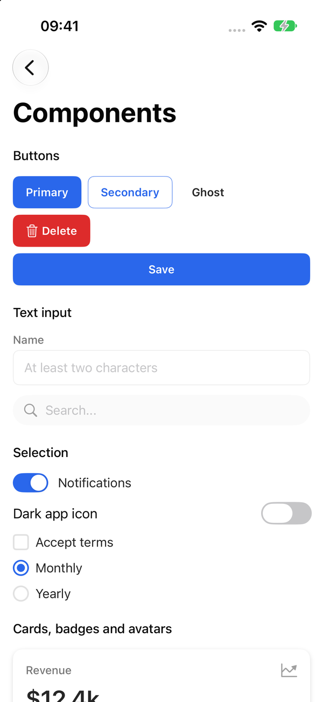
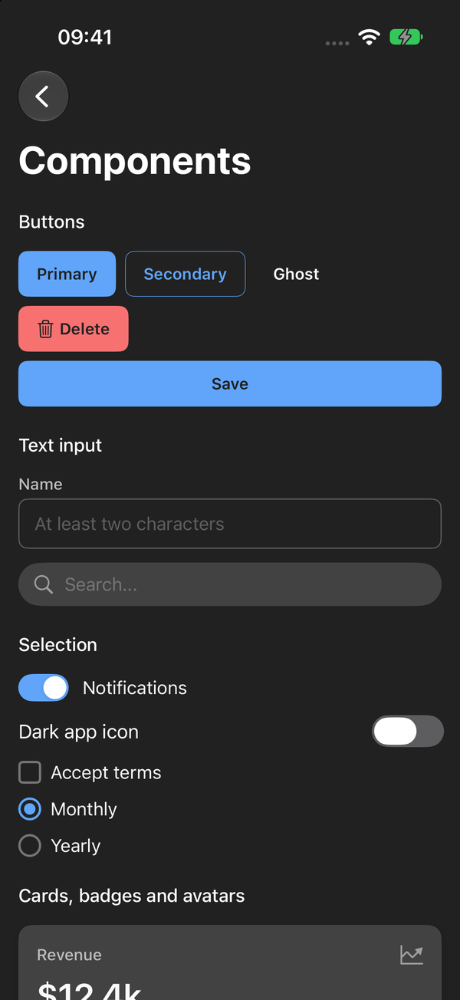

<!-- i18n-source: README.md@a23098c97b4f4bb69364e91c9e976f4231d3da06 status=reviewed -->
<!-- brand:start -->

<p align="center"><picture><source media="(prefers-color-scheme: dark)" srcset="https://raw.githubusercontent.com/muhittincamdali/SwiftUI-Design-System-Pro/main/.github/brand/banner-ko-dark.svg"><source media="(prefers-color-scheme: light)" srcset="https://raw.githubusercontent.com/muhittincamdali/SwiftUI-Design-System-Pro/main/.github/brand/banner-ko-light.svg"></picture></p>

<!-- lang-selector:start -->
<p align="center"><a href="README.md">English</a> · <a href="README.tr.md">Türkçe</a> · <a href="README.zh-CN.md">简体中文</a> · <a href="README.ja.md">日本語</a> · <a href="README.ko.md">한국어</a> · <a href="README.es.md">Español</a> · <a href="README.de.md">Deutsch</a> · <a href="README.fr.md">Français</a> · <a href="README.pt-BR.md">Português (Brasil)</a> · <a href="README.ru.md">Русский</a></p>
<!-- lang-selector:end -->

<p align="center">
<a href="https://github.com/muhittincamdali/SwiftUI-Design-System-Pro/actions/workflows/ci.yml"></a>
<a href="https://github.com/muhittincamdali/SwiftUI-Design-System-Pro/releases"><picture><source media="(prefers-color-scheme: dark)" srcset="https://raw.githubusercontent.com/muhittincamdali/SwiftUI-Design-System-Pro/main/.github/brand/badge-version-dark.svg"><source media="(prefers-color-scheme: light)" srcset="https://raw.githubusercontent.com/muhittincamdali/SwiftUI-Design-System-Pro/main/.github/brand/badge-version-light.svg"></picture></a>
<a href="https://github.com/muhittincamdali/SwiftUI-Design-System-Pro/blob/main/Package.swift"><picture><source media="(prefers-color-scheme: dark)" srcset="https://raw.githubusercontent.com/muhittincamdali/SwiftUI-Design-System-Pro/main/.github/brand/badge-platforms-dark.svg"><source media="(prefers-color-scheme: light)" srcset="https://raw.githubusercontent.com/muhittincamdali/SwiftUI-Design-System-Pro/main/.github/brand/badge-platforms-light.svg"></picture></a>
<a href="https://github.com/muhittincamdali/SwiftUI-Design-System-Pro/blob/main/Package.swift"><picture><source media="(prefers-color-scheme: dark)" srcset="https://raw.githubusercontent.com/muhittincamdali/SwiftUI-Design-System-Pro/main/.github/brand/badge-language-dark.svg"><source media="(prefers-color-scheme: light)" srcset="https://raw.githubusercontent.com/muhittincamdali/SwiftUI-Design-System-Pro/main/.github/brand/badge-language-light.svg"></picture></a>
<a href="https://github.com/muhittincamdali/SwiftUI-Design-System-Pro/blob/main/LICENSE"><picture><source media="(prefers-color-scheme: dark)" srcset="https://raw.githubusercontent.com/muhittincamdali/SwiftUI-Design-System-Pro/main/.github/brand/badge-license-dark.svg"><source media="(prefers-color-scheme: light)" srcset="https://raw.githubusercontent.com/muhittincamdali/SwiftUI-Design-System-Pro/main/.github/brand/badge-license-light.svg"></picture></a>
</p>

<p align="center">
<a href="#빠른-시작"><picture><source media="(prefers-color-scheme: dark)" srcset="https://raw.githubusercontent.com/muhittincamdali/SwiftUI-Design-System-Pro/main/.github/brand/button-start-ko-dark.svg"><source media="(prefers-color-scheme: light)" srcset="https://raw.githubusercontent.com/muhittincamdali/SwiftUI-Design-System-Pro/main/.github/brand/button-start-ko-light.svg"></picture></a>
<a href="https://muhittincamdali.github.io/SwiftUI-Design-System-Pro/documentation/designsystempro/"><picture><source media="(prefers-color-scheme: dark)" srcset="https://raw.githubusercontent.com/muhittincamdali/SwiftUI-Design-System-Pro/main/.github/brand/button-docs-ko-dark.svg"><source media="(prefers-color-scheme: light)" srcset="https://raw.githubusercontent.com/muhittincamdali/SwiftUI-Design-System-Pro/main/.github/brand/button-docs-ko-light.svg"></picture></a>
<a href="https://github.com/muhittincamdali/SwiftUI-Design-System-Pro/tree/main/Examples"><picture><source media="(prefers-color-scheme: dark)" srcset="https://raw.githubusercontent.com/muhittincamdali/SwiftUI-Design-System-Pro/main/.github/brand/button-examples-ko-dark.svg"><source media="(prefers-color-scheme: light)" srcset="https://raw.githubusercontent.com/muhittincamdali/SwiftUI-Design-System-Pro/main/.github/brand/button-examples-ko-light.svg"></picture></a>
</p>

> 이 문서는 영어 README의 번역본입니다. 내용이 다를 경우 영어 버전이 최신입니다.

<!-- brand:end -->

DesignSystemPro는 일관된 디자인을 처음부터 직접 만들고 싶지 않은 SwiftUI 앱을 위한 Swift 패키지입니다. 디자인 토큰(색상, 타이포그래피, 간격, 테두리, 그림자, 모션), 라이트·다크·프리셋·브랜드 테마를 다루는 테마 엔진, 그리고 토큰 위에 만든 약 40개의 컴포넌트 뷰(버튼, 텍스트 필드, 토글, 카드, 배지, 아바타, 토스트, 스켈레톤 로더)가 들어 있습니다. 모든 컴포넌트는 라이트 모드와 다크 모드에 맞는 색상을 선택하고, 타이포그래피 토큰으로 꾸민 텍스트는 Dynamic Type을 따릅니다.

## 주요 기능

- **라이트 모드와 다크 모드** — 모든 색상 토큰에 라이트, 다크, 고대비 값이 있고, 컴포넌트는 환경(environment)에서 알맞은 값을 고릅니다.
- **Dynamic Type** — `dsTypography(_:)`가 사용자의 텍스트 크기 설정에 맞춰 글꼴 스타일을 조절합니다.
- **직접 만든 뷰를 위한 테마** — `ThemeManager`는 시스템 설정을 따르거나, 프리셋 또는 브랜드 색상으로 만든 테마를 적용합니다. 테마는 `@Environment(\.dsTheme)`로 읽습니다.
- **명암비 검사** — `ColorContrastUtility`가 WCAG 명암비를 계산하고, 테스트는 두 색상 모드 모두에서 본문 텍스트와 채워진 버튼 레이블을 WCAG AA 기준으로 검사합니다.
- **테스트된 렌더링** — 각 컴포넌트 그룹을 라이트와 다크 모드로 렌더링해 저장된 참조 지문과 비교하는 테스트가 있어, 색상이나 레이아웃이 바뀌면 CI가 실패합니다.
- **다섯 개 플랫폼** — iOS, macOS, tvOS, watchOS, visionOS를 런타임 의존성 없는 패키지 하나로 지원합니다.

## 빠른 시작

**1. 패키지 추가**

Xcode에서 **File › Add Package Dependencies…**를 선택하고 저장소 URL을 입력하세요.

```text
https://github.com/muhittincamdali/SwiftUI-Design-System-Pro.git
```

**Dependency Rule**을 **Branch**로 바꾸고 `main`을 입력한 다음 **Add Package**를 클릭하세요. 다음 창에서 **DesignSystemPro** 줄에 앱 타깃을 선택하고 **Add Package**를 다시 클릭하세요. (이 API를 담은 첫 릴리스인 2.0.0은 아직 태그가 없습니다. 태그가 생기면 대신 **Up to Next Major Version**을 선택하세요.)

**2. 모듈 가져오기**

컴포넌트를 사용할 Swift 파일 맨 위에 다음 줄을 추가하세요.

```swift
import DesignSystemPro
```

**3. 사용하기**

새 SwiftUI 앱 프로젝트의 `ContentView.swift` 내용을 아래 코드로 바꾸고 앱을 실행하세요(**Product › Run**, ⌘R). 제목, 초록색 "Ready" 배지, 토글, 그리고 토글을 켜고 끄는 전체 너비 버튼이 나타납니다.

```swift
import DesignSystemPro
import SwiftUI

struct ContentView: View {
    @State private var notificationsOn = true

    var body: some View {
        VStack(spacing: SpacingTokens.Content.comfortable) {
            Text("Hello, DesignSystemPro")
                .dsTypography(TypographyTokens.Heading.h2)

            DSStatusBadge("Ready", variant: .success)

            DSToggle(isOn: $notificationsOn, label: "Notifications")

            DSButton("Continue", isFullWidth: true) {
                notificationsOn.toggle()
            }
        }
        .padding(SpacingTokens.Layout.screenEdge)
    }
}
```

같은 파일이 예제 앱에도 있습니다:
[Examples/DesignSystemProDemo/Sources/ContentView.swift](Examples/DesignSystemProDemo/Sources/ContentView.swift).

## 설치

### Swift Package Manager

Xcode에서 **File › Add Package Dependencies…**를 선택하고 저장소 URL을 입력하세요.

```text
https://github.com/muhittincamdali/SwiftUI-Design-System-Pro.git
```

또는 `Package.swift`의 `dependencies`에 추가하세요.

```swift
dependencies: [
    .package(url: "https://github.com/muhittincamdali/SwiftUI-Design-System-Pro.git", branch: "main")
],
targets: [
    .target(name: "YourApp", dependencies: [
        .product(name: "DesignSystemPro", package: "SwiftUI-Design-System-Pro")
    ])
]
```

최신 태그인 1.0.0은 이 README에서 다루지 않는 예전 1.x API입니다. 2.0.0 태그가 생기기 전까지는 `branch: "main"`을, 그 후에는 `from: "2.0.0"`을 사용하세요.

## 사용법

### 테마 프로바이더와 토스트 오버레이 설치

루트 뷰를 `DSApp`으로 감싸세요. `DSApp`은 현재 테마를 환경에 넣고, 토스트를 표시하는 오버레이를 추가합니다.

```swift
import DesignSystemPro
import SwiftUI

@main
struct MyApp: App {
    var body: some Scene {
        WindowGroup {
            DSApp { ContentView() }
        }
    }
}
```

### 컴포넌트로 화면 만들기

컴포넌트는 일반 값과 바인딩을 받고, 간격과 글꼴은 토큰에서 가져옵니다. 다음은 예제 앱의 로그인 화면입니다.

```swift
struct SignInView: View {
    @State private var email = ""
    @State private var isSubmitting = false

    var body: some View {
        VStack(spacing: SpacingTokens.Content.comfortable) {
            Text("Welcome back").dsTypography(TypographyTokens.Heading.h2)

            DSTextField("Email", text: $email, placeholder: "you@example.com")

            DSButton("Sign in", isFullWidth: true) {
                isSubmitting = true
                DSToastManager.shared.success("Signed in")
            }
            .loading(isSubmitting)

            HStack {
                DSAvatar(name: "Ada Lovelace", status: .online)
                DSStatusBadge("Verified", variant: .success)
            }
        }
        .padding(SpacingTokens.Layout.screenEdge)
        .frame(maxWidth: .infinity, maxHeight: .infinity)
        .dsBackgroundColor(ColorTokens.Background.primary)
    }
}
```

### 테마 선택

테마를 지정하기 전까지 `ThemeManager`는 시스템의 라이트/다크 설정을 따릅니다.

```swift
// Follow the system light/dark setting (the default) ...
DesignSystemPro.configure()

// ... or force a preset or a generated brand theme.
ThemeManager.shared.setTheme(PresetThemes.ocean)

let brand = BrandConfiguration(primaryColor: .purple, secondaryColor: .pink, borderRadius: 12)
ThemeManager.shared.setTheme(WhiteLabelConfiguration(brand: brand, appName: "Acme").darkTheme)
```

직접 만든 뷰는 `@Environment(\.dsTheme)`로 현재 테마를 읽습니다. 기본 제공 컴포넌트는 색상 토큰을 직접 사용하므로 테마에 따라 스타일이 바뀌지 않습니다.

### 명암비 확인

```swift
let ratio = ColorContrastUtility.contrastRatio(.white, Color(hex: "#2563EB")) // about 5.2
let passes = ColorContrastUtility.meetsWCAG_AA(.white, Color(hex: "#2563EB")) // true
```

이 README의 모든 Swift 코드(`Package.swift` 발췌 제외)는
[Tests/DesignSystemProTests/ReadmeExamples.swift](Tests/DesignSystemProTests/ReadmeExamples.swift)에서
컴파일되고 실행됩니다.

## 데모

[Examples/DesignSystemProDemo](Examples/DesignSystemProDemo)의 예제 앱은 iOS와 macOS에서 실행되며, 빠른 시작, 로그인 폼, 각 컴포넌트 계열, 테마 화면을 담고 있습니다. `Examples/DesignSystemProDemo/DesignSystemProDemo.xcodeproj`를 열고 iPhone 시뮬레이터를 선택한 뒤 ⌘R을 누르세요. 각 화면은 [Examples/README.md](Examples/README.md)에 설명되어 있습니다.

| 라이트                                                                                                   | 다크                                                                                                  |
| -------------------------------------------------------------------------------------------------------- | ----------------------------------------------------------------------------------------------------- |
|  |  |
|                                                            |                                                            |
|                                                    |                                                    |

컴포넌트 이미지는 테스트 타깃의 갤러리를 SwiftUI의 `ImageRenderer`로 렌더링한 것입니다(`scripts/render-screenshots.sh`). 더 보기: [카드](docs/images/cards-light.png), [선택 컨트롤](docs/images/selection-light.png), [토스트와 스켈레톤](docs/images/feedback-dark.png).

## 문서

API 레퍼런스와 문서:

- GitHub Pages의 [DesignSystemPro 문서](https://muhittincamdali.github.io/SwiftUI-Design-System-Pro/documentation/designsystempro/): 모든 공개 타입을 토큰, 테마, 컴포넌트 계열별로 정리했습니다.
- DocC 카탈로그는 [Sources/DesignSystemPro/DesignSystemPro.docc](Sources/DesignSystemPro/DesignSystemPro.docc)에 있습니다. 로컬에서는 `swift package generate-documentation --target DesignSystemPro`로 빌드할 수 있습니다.

## 가이드

- [Getting Started](https://muhittincamdali.github.io/SwiftUI-Design-System-Pro/documentation/designsystempro/gettingstarted): 패키지 추가, 루트 뷰 감싸기, 첫 컴포넌트 사용.
- [Building a Form](https://muhittincamdali.github.io/SwiftUI-Design-System-Pro/documentation/designsystempro/buildingaform): 입력 검증, 로딩 중인 버튼, 토스트를 한 화면에 조합하기.
- [Using Design Tokens](https://muhittincamdali.github.io/SwiftUI-Design-System-Pro/documentation/designsystempro/usingdesigntokens): 색상, 타이포그래피, 간격, 모션.
- [Theming](https://muhittincamdali.github.io/SwiftUI-Design-System-Pro/documentation/designsystempro/theming): 프리셋, 브랜드 테마, 테마 관리자.

## 요구 사항

| 플랫폼   | 최소 버전             |
| -------- | --------------------- |
| iOS      | 17                    |
| macOS    | 14                    |
| watchOS  | 10                    |
| tvOS     | 17                    |
| visionOS | 1                     |
| 툴체인   | Swift 6.0 · Xcode 26+ |

CI는 Xcode 26.6으로 빌드하고, 개발은 Xcode 27로 합니다. `DSTextArea`는 `TextEditor`를 사용하므로 tvOS와 watchOS에서는 사용할 수 없습니다.

## 아키텍처

```text
Sources/DesignSystemPro
├── Tokens/      ColorTokens, TypographyTokens, SpacingTokens, BorderTokens, ShadowTokens, AnimationTokens
├── Theme/       DSTheme, ThemeManager, DSThemeProvider, presets, brand/white-label generation
├── Components/  Buttons, text input, selection, cards, badges, avatars, toasts, skeletons
└── DesignSystemPro.swift   configure() and DSApp
```

| 계열        | 뷰                                                                                                              |
| ----------- | --------------------------------------------------------------------------------------------------------------- |
| 버튼        | `DSButton`(변형 6종, 크기 5종, 아이콘, 로딩 상태), `DSIconButton`, `DSButtonGroup`                              |
| 텍스트 입력 | `DSTextField`(검증 상태, 보안 입력), `DSTextArea`, `DSSearchField`, `DSOTPField`                                |
| 선택        | `DSToggle`, `DSSwitch`, `DSCheckbox`, `DSCheckboxGroup`, `DSRadio`, `DSRadioGroup`                              |
| 콘텐츠      | `DSCard`, `DSCardHeader`, `DSCardFooter`, `DSStatCard`, `DSMediaCard`, `DSListCard`, `DSCardListItem`           |
| 배지        | `DSBadge`, `DSCounterBadge`, `DSDotBadge`, `DSStatusBadge`, `DSTag`                                             |
| 아바타      | `DSAvatar`(이미지, 이니셜 또는 플레이스홀더, 상태 점), `DSAvatarGroup`, `DSBorderedAvatar`, `DSAvatarWithBadge` |
| 피드백      | `DSToastManager`와 `DSToastContainer`/`DSToastView`, `DSSnackbar`                                               |
| 로딩        | `DSSkeleton`과 텍스트, 아바타, 카드, 목록, 표, 프로필 스켈레톤; `DSConditionalSkeleton`                         |

- 컴포넌트는 토큰으로 만들어지며 테마를 읽지 않습니다. 토큰은 단순한 `Sendable` 값 타입입니다.
- `ThemeManager`와 `DSToastManager`는 공유 인스턴스와 공개 이니셜라이저를 가진 `@MainActor` `@Observable` 클래스라서, 주입(`DSThemeProvider(themeManager:)`, `DSToastContainer(manager:)`)하고 테스트할 수 있습니다.
- 테스트(`swift test`)는 Swift Testing을 사용하며 토큰 계산, 명암비, 테마 결정, 토스트 큐와 타이머, 컴포넌트 헬퍼, 문서의 코드 조각, 각 컴포넌트 그룹의 라이트/다크 참조 지문, 그리고 테마 프로바이더·스위치 색상·OTP 포커스 테두리를 확인하기 위해 AppKit에 호스팅한 뷰를 다룹니다. CI는 iOS 시뮬레이터에서도 테스트를 실행합니다.

## 로드맵

- 2.0.0 태그를 만들고 [CHANGELOG.md](CHANGELOG.md)를 바탕으로 릴리스 노트를 게시합니다.
- 컴포넌트가 현재 테마를 읽도록 해서 프리셋과 브랜드 테마가 컴포넌트 스타일도 바꾸게 합니다.
- 밝은 팔레트 색상 위의 아바타 이니셜과 다크 모드 체크박스 체크 표시의 명암비를 WCAG AA 수준으로 높입니다.

이 패키지는 2026년 6월에 자리표시 파일만 남은 상태가 되었습니다. 2.0은 이전의 토큰, 테마 엔진, 컴포넌트를 복원하고, 그 과정에서 찾은 버그를 고치고, 테스트를 추가했습니다. 1.x API의 컴포넌트(알림, 모달, 내비게이션 바, 탭 바, 차트)는 복원하지 않았습니다. 아이디어와 버그 제보는 [issue](https://github.com/muhittincamdali/SwiftUI-Design-System-Pro/issues)로 남겨 주세요.

## 기여하기

기여를 환영합니다. pull request를 열기 전에 [기여 가이드](https://github.com/muhittincamdali/SwiftUI-Design-System-Pro/blob/main/CONTRIBUTING.md)와 [행동 강령](https://github.com/muhittincamdali/.github/blob/main/CODE_OF_CONDUCT.md)을 읽어 주세요. 보안 문제는 [보안 정책](https://github.com/muhittincamdali/.github/blob/main/SECURITY.md)에 따라 비공개로 제보해 주세요.

## 라이선스

MIT 라이선스로 배포됩니다. 자세한 내용은 [LICENSE](LICENSE)를 참고하세요.
