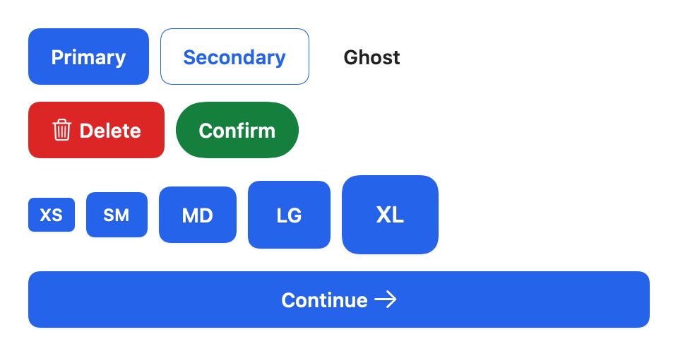
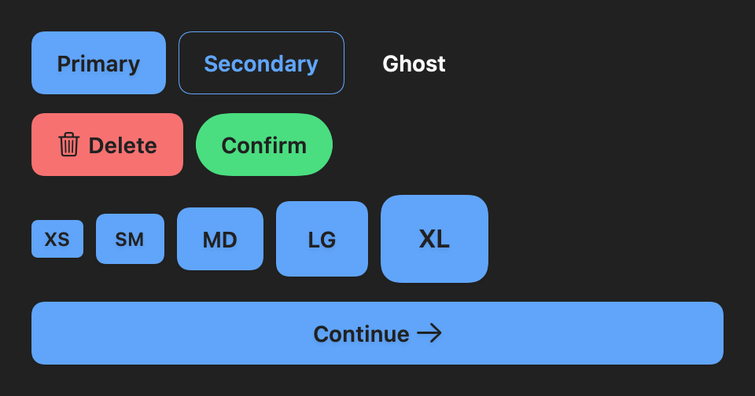
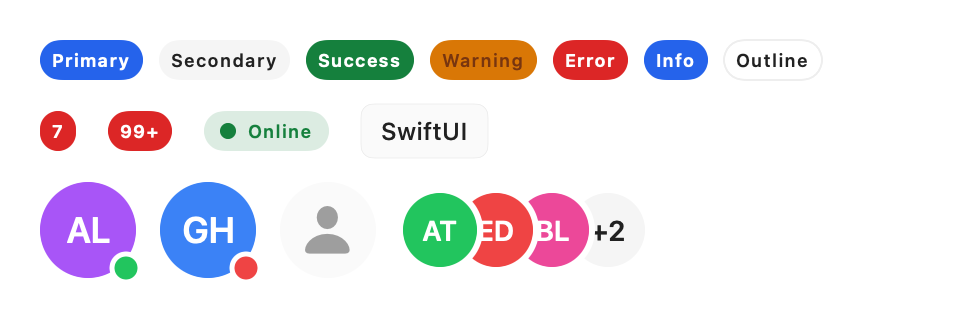
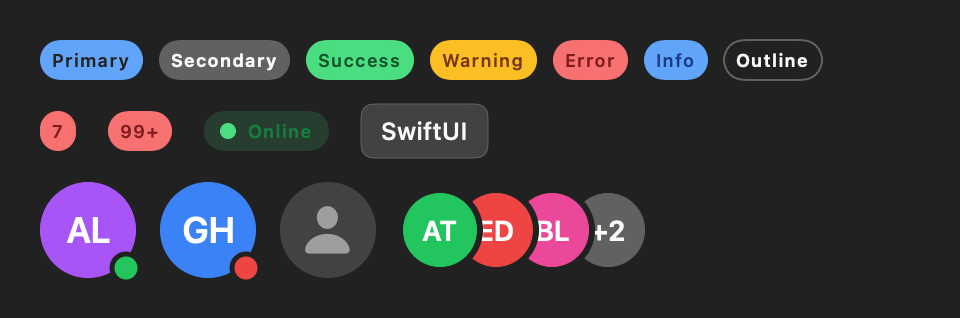

# SwiftUI Design System Pro

[](https://github.com/muhittincamdali/SwiftUI-Design-System-Pro/actions/workflows/ci.yml)
[](LICENSE)

Design tokens, a theme engine and SwiftUI components built on them, packaged as
one Swift package (`DesignSystemPro`). Every component resolves its colors for
light and dark mode, and text styled with the typography tokens follows
Dynamic Type.

| Light                                                      | Dark                                                     |
| ---------------------------------------------------------- | -------------------------------------------------------- |
|            |            |
|  |  |

More screenshots: [cards](docs/images/cards-light.png),
[selection controls](docs/images/selection-light.png),
[toasts and skeletons](docs/images/feedback-dark.png). They are rendered from
the component gallery in the test target with SwiftUI's `ImageRenderer`
(`scripts/render-screenshots.sh`), not mocked up.

## What is in the package

**Tokens**

- Colors: a primitive palette plus semantic roles (`ColorTokens.Background`,
  `Foreground`, `Accent`, `Status`, `Border`, `Interactive`), each with light,
  dark and high-contrast values; hex parsing and a WCAG contrast calculator.
- Typography: display, heading, body, UI and code styles; `dsTypography(_:)`
  scales them with Dynamic Type. `FluidTypography` interpolates a size between
  two widths.
- Spacing (`SpacingScale`, `SpacingTokens`), corner radii and borders
  (`BorderTokens`), multi-layer shadows with elevation levels (`ShadowTokens`,
  `Elevation`), animation durations, curves and spring presets
  (`AnimationTokens`, `SpringConfig`).

**Theme engine**

- `DSTheme` with `LightTheme`, `DarkTheme`, `CustomTheme` and four color presets
  (`PresetThemes.ocean`, `forest`, `sunset`, `lavender`).
- `ThemeManager` follows the system color scheme or a theme you set;
  `DSThemeProvider` exposes it as `@Environment(\.dsTheme)`.
- `BrandConfiguration` and `WhiteLabelConfiguration` generate light and dark
  themes from brand colors.

The components use the color tokens directly; the active theme is for your own
views and is not applied to the built-in components.

**Components**

| Family     | Views                                                                                                             |
| ---------- | ----------------------------------------------------------------------------------------------------------------- |
| Buttons    | `DSButton` (6 variants, 5 sizes, icons, loading state), `DSIconButton`, `DSButtonGroup`                           |
| Text input | `DSTextField` (validation states, secure entry), `DSTextArea`, `DSSearchField`, `DSOTPField`                      |
| Selection  | `DSToggle`, `DSSwitch`, `DSCheckbox`, `DSCheckboxGroup`, `DSRadio`, `DSRadioGroup`                                |
| Content    | `DSCard`, `DSCardHeader`, `DSCardFooter`, `DSStatCard`, `DSMediaCard`, `DSListCard`, `DSCardListItem`             |
| Badges     | `DSBadge`, `DSCounterBadge`, `DSDotBadge`, `DSStatusBadge`, `DSTag`                                               |
| Avatars    | `DSAvatar` (image, initials or placeholder, status dot), `DSAvatarGroup`, `DSBorderedAvatar`, `DSAvatarWithBadge` |
| Feedback   | `DSToastManager` with `DSToastContainer`/`DSToastView`, `DSSnackbar`                                              |
| Loading    | `DSSkeleton` and text, avatar, card, list, table and profile skeletons; `DSConditionalSkeleton`                   |

`DSTextArea` is not available on tvOS and watchOS (it uses `TextEditor`).

## Requirements

- iOS 17, macOS 14, tvOS 17, watchOS 10 or visionOS 1
- Swift 6 toolchain (`swift-tools-version: 6.0`); developed with Xcode 27

## Installation

Swift Package Manager, in Xcode via **File > Add Package Dependencies…** or in
`Package.swift`:

```swift
dependencies: [
    .package(url: "https://github.com/muhittincamdali/SwiftUI-Design-System-Pro.git", from: "2.0.0")
],
targets: [
    .target(name: "MyApp", dependencies: [
        .product(name: "DesignSystemPro", package: "SwiftUI-Design-System-Pro")
    ])
]
```

> `2.0.0` is the first release with this API. Until it is tagged, depend on
> `branch: "main"`.

## Usage

Wrap the root view so the theme provider and the toast overlay are installed:

```swift
import DesignSystemPro
import SwiftUI

@main
struct MyApp: App {
    var body: some Scene {
        WindowGroup {
            DSApp { ContentView() }
        }
    }
}
```

Components and tokens:

```swift
struct SignInView: View {
    @State private var email = ""
    @State private var isSubmitting = false

    var body: some View {
        VStack(spacing: SpacingTokens.Content.comfortable) {
            Text("Welcome back").dsTypography(TypographyTokens.Heading.h2)

            DSTextField("Email", text: $email, placeholder: "you@example.com")

            DSButton("Sign in", isFullWidth: true) {
                isSubmitting = true
                DSToastManager.shared.success("Signed in")
            }
            .loading(isSubmitting)

            HStack {
                DSAvatar(name: "Ada Lovelace", status: .online)
                DSStatusBadge("Verified", variant: .success)
            }
        }
        .padding(SpacingTokens.Layout.screenEdge)
        .dsBackgroundColor(ColorTokens.Background.primary)
    }
}
```

Theming:

```swift
// Follow the system light/dark setting (the default) ...
DesignSystemPro.configure()

// ... or force a preset or a generated brand theme.
ThemeManager.shared.setTheme(PresetThemes.ocean)

let brand = BrandConfiguration(primaryColor: .purple, secondaryColor: .pink, borderRadius: 12)
ThemeManager.shared.setTheme(WhiteLabelConfiguration(brand: brand, appName: "Acme").darkTheme)
```

Contrast checks:

```swift
let ratio = ColorContrastUtility.contrastRatio(.white, Color(hex: "#2563EB")) // about 5.2
let passes = ColorContrastUtility.meetsWCAG_AA(.white, Color(hex: "#2563EB")) // true
```

The Swift snippets above (all except the `Package.swift` excerpt) are compiled
and run by the test target in `Tests/DesignSystemProTests/ReadmeExamples.swift`.

## Documentation

The DocC catalog in `Sources/DesignSystemPro/DesignSystemPro.docc` has a
getting-started guide and articles on tokens and theming. Build it locally with:

```bash
swift package generate-documentation --target DesignSystemPro
```

## Architecture

```
Sources/DesignSystemPro
├── Tokens/      ColorTokens, TypographyTokens, SpacingTokens, BorderTokens, ShadowTokens, AnimationTokens
├── Theme/       DSTheme, ThemeManager, DSThemeProvider, presets, brand/white-label generation
├── Components/  Buttons, text input, selection, cards, badges, avatars, toasts, skeletons
└── DesignSystemPro.swift   configure() and DSApp
```

Components are built from the tokens and do not read the theme. Tokens are plain value types (`Sendable`), and
the shared `ThemeManager` and `DSToastManager` are `@MainActor` `@Observable` classes. Both managers
have public initializers so they can be injected (`DSThemeProvider(themeManager:)`,
`DSToastContainer(manager:)`) and tested.

## Testing

```bash
swift test
```

The Swift Testing suites cover hex parsing, contrast math (including AA checks
for body text and filled-button labels in both color schemes), Dynamic Type
scaling, theme resolution, brand theme generation, the toast queue and timers,
OTP input sanitising, avatar initials and badge counts. A rendering test draws
every gallery section in light and dark mode. CI runs the suites on macOS and
an iOS simulator and builds the package for tvOS, watchOS and visionOS.

## Project history

The package was reduced to placeholder files in June 2026. Version 2.0 restores
the tokens, theme engine and components from the earlier implementation, fixes
the bugs found while doing so and adds tests; see [CHANGELOG.md](CHANGELOG.md).
Components from the older 1.x API (alerts, modals, navigation bar, tab bar,
charts) were not brought back.

## Contributing

See [CONTRIBUTING.md](CONTRIBUTING.md).

## License

MIT. See [LICENSE](LICENSE).
